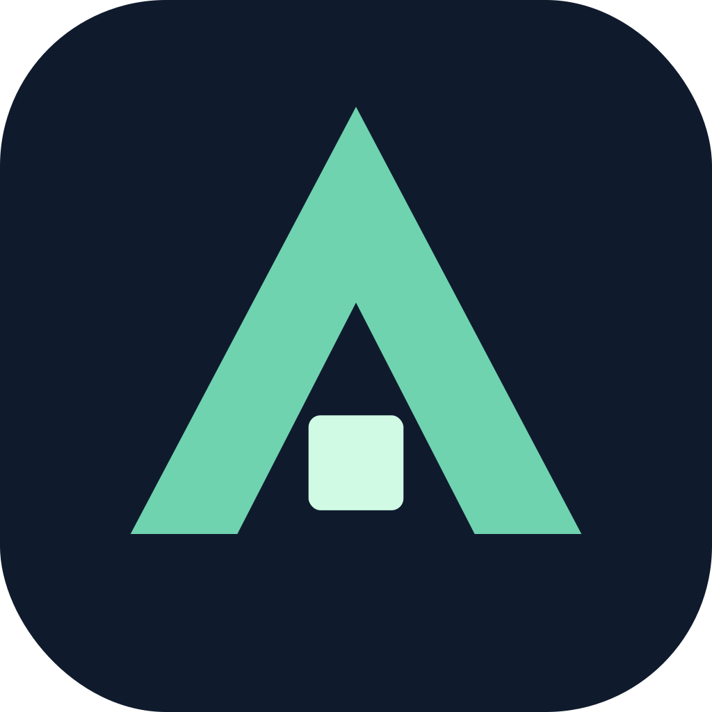

**Aevion Development**
**Minecraft management plugins made convenient.**

---

Aevion Development is a Minecraft plugin development team created to make running a server easier. We specialize in management plugins that are simple to set up, clean to configure, and reliable under real player counts, so server owners can spend less time on upkeep and more time growing their community.

## What We Build

- 🛡️ **Moderation tools** for staff, punishments, and reports
- 🗂️ **Server management** utilities, permissions, and admin panels
- 👥 **Player management** like profiles, ranks, and data handling
- ⚙️ **Config and performance tools** for easier maintenance
- 🔧 **Custom plugins** built to fit your server's needs

## Our Goals

- Easy installation and clean configs
- Solid performance at scale
- Fast updates for new versions
- Quick, friendly support

## Contact

- 💬 Discord: Coming Soon
- 🌐 Website: Coming Soon

---

*Built for convenience. Made for communities.*

